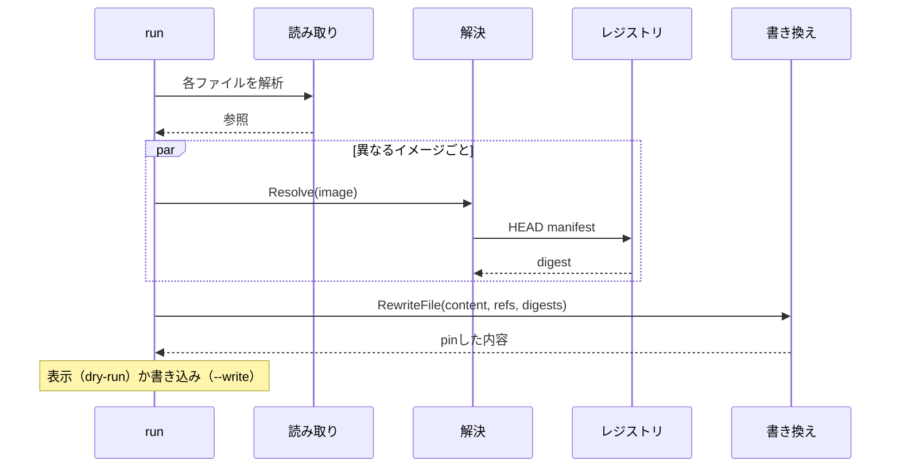

# pinの設計

[English](design.md)

## この文書について

この設計は、[dockerfile-pin](../../product.ja.md)で[pin](requirements.ja.md)をどう実装しているかを説明します。

### 想定読者

`run`コマンドやレジストリの解決を変える人とエージェント。

### 前提知識

OCIレジストリのAPIとgo-containerregistry。

### この文書で扱わないこと

参照の読み取りと書き換え、ファイルの探索、除外の規則は、それぞれの機能に属します。

## 実装方針

`run`（`cmd/pin.go`）は3つの段階で動きます。レジストリへのリクエストをイメージごとに1回にし、並列に行うためです。

1つ目の段階では、すべての対象ファイルを解析して`parsedFile`にします。`parsedFile`は、内容、種類、参照、解決が必要なイメージの一覧を持ちます。参照は、スキップされている、`--update`なしですでにdigestがある、除外パターンに一致する、のどれでもなければ、その一覧に入ります。解析に失敗したファイルは報告して外します。

2つ目の段階では、すべてのファイルの異なるイメージを集め、同時に解決します。同時に進めるのはCPU数の2倍までです。結果はイメージからdigestへのマップに入れます。失敗したら警告を表示し、そのイメージはマップに入れません。

3つ目の段階では、ファイルをもう一度たどります。対象になる参照で、イメージがマップにあるものに、参照の添字でdigestを割り当て、ファイルの種類の書き換えを呼びます。digestが1つも割り当てられないファイルは飛ばします。dry-runでは書き換えた内容を表示し、`--write`では既存のファイルから読んだモードで書き込みます。読めなければ`0644`を使います。
Dockerfileでは、書き換えが見つけられなかった参照も返すので、それを警告し、数から引きます。

### 解決

`internal/resolver`はgo-containerregistryを包んでいます。`Resolve`は参照を解析し、Dockerの設定を読む既定のキーチェーンでHEADリクエストを送り、返ってきた記述子のdigestを返します。各リクエストは、実行全体の10分の制限の中で、30秒で打ち切ります。
`DigestResolver`のインターフェースには、テスト用の`MockResolver`と、`check`が使う`CachedResolver`があります。

go-containerregistryを選んだのは、Googleが管理していて開発が活発なためです。この分野の以前のツールはメンテナンスが止まっていました。

## 構成図とシーケンス図

## データモデルとER図

`parsedFile`は、`path`、`fileType`、`content`、種類ごとの参照の一覧、`imageRefs`を持ちます。digestのマップは、イメージからdigestへの`map[string]string`です。

## APIとインターフェース

フラグは、`-f/--file`、`--glob`、`--write`、`-u/--update`、`--min-age`、`--ignore-images`です。
標準出力には進行状況と結果を、標準エラーには警告とファイルごとのエラーを出します。
`run`がエラーを返して終了コードが0以外になるのは、ファイルが見つからない、パターンが正しくないなど、段階が始まる前の失敗だけです。

## 外部サービスとの連携

レジストリには、`authn.DefaultKeychain`の認証情報でHTTPSを使ってアクセスします。リクエストの失敗は、そのイメージにだけ影響します。

## データの取り扱い

ファイルの内容とdigestはメモリーに持ちます。書き込むのは対象ファイルだけで、`--write`のときだけです。

## 認証・認可の注意点

認証はDockerの認証情報の設定に任せます。dockerfile-pin自身には認証情報のオプションがありません。

## セキュリティ上の考慮事項

書き込みではファイルの権限を保ち、制限されたファイルが誰でも読めるようにならないようにしています（[#41](https://github.com/azu/dockerfile-pin/pull/41)）。

## デプロイ時の注意点

ありません。

## 検討した代替手段

### `--platform`オプション

最初の設計には、マルチアーキテクチャのイメージのプラットフォームを選ぶ`--platform`がありました。このフラグは登録されていただけで使われておらず、削除しました（[#25](https://github.com/azu/dockerfile-pin/pull/25)）。書き込むdigestはタグが指しているもので、マルチアーキテクチャのイメージではインデックスのdigestです。

### 既定で書き込む

最初の版ではコマンド名が`pin`で、`--dry-run`フラグがありました。その後`run`に改名し、dry-runを既定にしました。頼まれたときだけファイルを変えるコマンドのほうが安全なためです。結果を表示するのが既定で、`--write`を付けたときだけファイルを書き換える[Prettier](https://prettier.io/docs/cli)などのツールにならっています。

## 未決事項

ありません。
