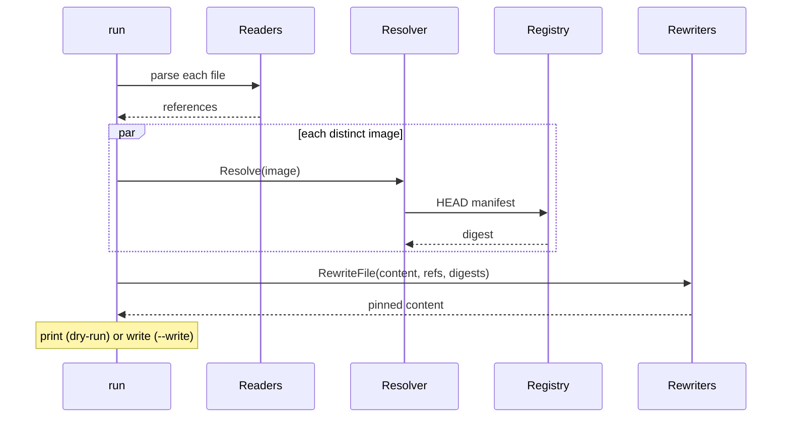

# Pinning design

[日本語](design.ja.md)

## About this document

This design describes how [Pinning](requirements.md) is implemented in [dockerfile-pin](../../product.md).

### Audience

People and agents who change the `run` command or the registry resolver.

### Prerequisites

The OCI registry API and go-containerregistry.

### Outside this document

Reading and rewriting references, file discovery, and ignore rules belong to their own features.

## Implementation approach

`run` (`cmd/pin.go`) works in three phases so that registry requests are made once per image and in parallel.

In the first phase it parses every target file into a `parsedFile`, which keeps the content, the kind, the references, and the list of images that need resolving. A reference is added to that list unless it is skipped, already has a digest without `--update`, or matches an ignore pattern. A file that fails to parse is reported and dropped.

In the second phase it collects the distinct images of all files and resolves them concurrently, with at most twice the number of CPUs in flight. Each result goes into a map from image to digest; a failure prints a warning and leaves the image out of the map.

In the third phase it goes through the files again. For each reference that is eligible and whose image is in the map, it assigns the digest by reference index and calls the rewriter for the file's kind. A file with no assigned digest is skipped. In dry-run the rewritten content is printed; with `--write` it is written with the mode read from the existing file, falling back to `0644`.
For Dockerfiles the rewriter also returns the references it could not find, which are warned about and subtracted from the count.

### Resolver

`internal/resolver` wraps go-containerregistry. `Resolve` parses the reference and sends a HEAD request with the default keychain, which reads the Docker configuration, and returns the descriptor's digest. Each request has a 30 second timeout inside the run's 10 minute context.
The `DigestResolver` interface has a `MockResolver` for tests and a `CachedResolver` used by `check`.

go-containerregistry was chosen because it is maintained by Google and actively developed, while the earlier tools in this space had stalled.

## Architecture and sequence diagrams

## Data model and ER diagrams

`parsedFile` holds `path`, `fileType`, `content`, one reference list per kind, and `imageRefs`. The digest map is `map[string]string` from image to digest.

## APIs and interfaces

Flags: `-f/--file`, `--glob`, `--write`, `-u/--update`, `--min-age`, `--ignore-images`.
Standard output carries progress and results; standard error carries warnings and per-file errors.
`run` returns an error, and a non-zero exit code, only for failures before the phases start, such as no files found or an invalid pattern.

## External service integration

Registries are reached over HTTPS with the credentials of `authn.DefaultKeychain`. A failed request affects only its image.

## Data handling

File content and digests are held in memory. Only target files are written, and only with `--write`.

## Authentication and authorization notes

Authentication is delegated to the Docker credential configuration; dockerfile-pin has no credential options of its own.

## Security considerations

Writing preserves file permissions so that a restricted file does not become world-readable ([#41](https://github.com/azu/dockerfile-pin/pull/41)).

## Deployment notes

None.

## Alternatives considered

### A `--platform` option

The original design had `--platform` to choose the platform of multi-architecture images. The flag was registered but never used and was removed ([#25](https://github.com/azu/dockerfile-pin/pull/25)); the digest written is the one the tag points to, which for a multi-architecture image is the index.

### Writing by default

The first version named the command `pin` with a `--dry-run` flag; it was renamed to `run` with dry-run as the default, because a command that changes files only when asked is safer. This follows tools such as [Prettier](https://prettier.io/docs/cli), which prints the result by default and rewrites files only with `--write`.

## Open questions

None.
