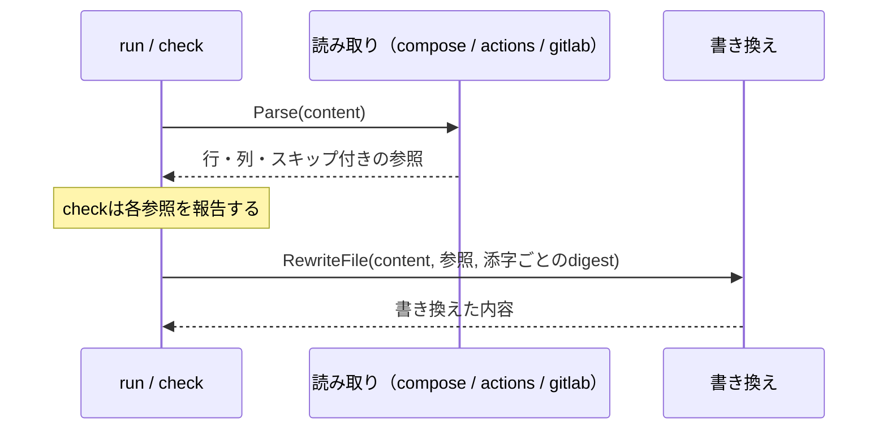

# YAMLのイメージ参照の設計

[English](design.md)

## この文書について

この設計は、[dockerfile-pin](../../product.ja.md)のコマンドラインツールで、[YAMLのイメージ参照](requirements.ja.md)が定める参照をどう読み取り、どうdigestを書き込むかを説明します。

### 想定読者

composeファイル、GitHub Actionsのファイル、GitLab CIのファイルの読み取りや書き換えを変える人とエージェント。

### 前提知識

YAMLのノード、アンカー、エイリアス、マージキーの考え方と、[YAMLのマージキーの型](https://yaml.org/type/merge.html)。

### この文書で扱わないこと

ファイルの種類を決めること、digestを解決すること、`run`と`check`の出力は、それぞれの機能で説明します。

## 実装方針

YAMLのファイルの種類ごとに、同じ形の読み取りと書き換えがあります。`internal/compose`、`internal/actions`、`internal/gitlab`です。
`run`と`check`は、ファイルの読み取りを呼んで参照を受け取り、digestが必要な参照を決めます。`run`はその後、選んだdigestを同じファイルの書き換えに渡します。

### 読み取り

読み取りは、ファイルを`gopkg.in/yaml.v3`の`yaml.Node`の木に変換します。ノードは、その文字列が始まる行と列を持っています。
Requirementsに挙げたキーだけをたどり、`findMapValue`という補助関数で、マッピングのキーと値の組から指定した文字列のキーを探し、その値のノードを返します。
見つけた値ごとに、書かれたままの文字列を記録し、最初の`@`でイメージとdigestに分け、スキップの規則に当てはまれば印を付けます。

`findMapValue`はキーの文字列だけを比べます。
エイリアスのノードを、それが指すノードまでたどりません。マージキー`<<`も普通のキーとして扱うので、サービスやジョブにマージされたマッピングは探しません。
見つけた値がエイリアスそのものだった場合、GitHub ActionsとGitLab CIの読み取りはスカラーのノードしか受け付けないので捨てます。composeの読み取りは、エイリアスのノードの値、つまりアンカーの名前を取ります。

GitLab CIの読み取りは、CIコンポーネントが`spec:`を別のヘッダー文書に書くので、デコーダーを繰り返し呼んでファイルのすべての文書を読みます。

### 書き換え

書き換えは、内容を行に分け、選んだ各参照を記録した行の中で置き換えます。
1行にある参照は、右の列から左へ順に処理します。digestを挿入してもずれるのはその後ろの文字列だけなので、まだ処理していない参照の列が正しいまま残るためです。
各参照は、記録した列の位置にそのまま差し込むのではなく、その列から参照の文字列を探します。引用符で囲んだスカラーの列は、開きの引用符を指すためです。
新しい文字列は、既存の`@`より前のイメージに`@`とdigestを続けたものです。`docker://`の接頭辞があったGitHub Actionsの参照には、接頭辞を付け直します。

列を基準にした置き換えは[#51](https://github.com/azu/dockerfile-pin/pull/51)で入りました。フロー構文では1行に複数の参照が並び、ある参照がほかの参照の先頭部分と同じことがあり、digestの長さで列がずれるためです。
ノードの木から書き出し直さずに、ファイルを文字列として変える理由は記録がありません。

## 構成図とシーケンス図

## データモデルとER図

各読み取りは、それぞれの参照の型`ComposeImageRef`、`ActionsImageRef`、`GitLabImageRef`を返します。
共通するのは、`RawRef`（書かれたままの文字列）、`ImageRef`（digestなし）、`Digest`、`Line`と`Column`（1始まり）、`Skip`、`SkipReason`です。
`ComposeImageRef`は`ServiceName`を、`ActionsImageRef`は`Location`と`docker://`用の`HasPrefix`を、`GitLabImageRef`は`Location`と参照を持つキーの`Key`を加えます。
各ファイルから得るのは平らな一覧なので、関連の図は必要ありません。

## APIとインターフェース

### 読み取り

`Parse(content []byte)`は、1つのファイルの参照を見つけた順に返します。
内容がYAMLとして正しくないときは、`parsing YAML`を含むエラーを返します。呼び出し側はファイル名付きでエラーを表示し、次のファイルへ進みます。
composeファイルのルートがマッピングでないか、`services`がマッピングでないときはエラーです。GitHub ActionsとGitLab CIのファイルでは、そのような形からは参照が出てきません。

### 書き換え

`RewriteFile(content string, refs []..., digests map[int]string)`は書き換えた内容を返します。
`digests`のキーは`refs`の中の参照の添字です。スキップする参照とエントリのない参照は変えません。
列から参照の文字列が見つからないときは、その行を変えません。

## 外部サービスとの連携

ありません。依存するのは`gopkg.in/yaml.v3`のライブラリだけです。ほかのYAMLライブラリではなくこれを選んだ理由は記録がありません。

## データの取り扱い

参照はコマンドの実行中にメモリーにあるだけです。何も保存しません。

## 認証・認可の注意点

ありません。この機能は、コマンドを実行した利用者の権限でローカルのファイルを読み書きします。

## セキュリティ上の考慮事項

書き換えは、記録した行にある参照の文字列だけを変えるので、ファイルのほかの部分は1バイトも変わらずに書き戻されます。

## デプロイ時の注意点

ありません。

## 検討した代替手段

読み取りと書き換えについて検討した代替手段の記録はありません。

## 未決事項

ありません。
