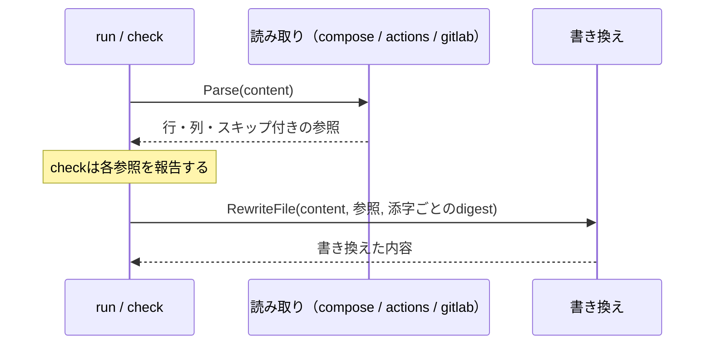

# YAMLのイメージ参照の設計

[English](design.md)

## この文書について

この設計は、[dockerfile-pin](../../product.ja.md)のコマンドラインツールで、[YAMLのイメージ参照](requirements.ja.md)が定める参照をどう読み取り、どうdigestを書き込むかを説明します。

### 想定読者

composeファイル、GitHub Actionsのファイル、GitLab CIのファイルの読み取りや書き換えを変える人とエージェント。

### 前提知識

YAMLのノード、アンカー、エイリアス、マージキーの考え方と、[YAMLのマージキーの型](https://yaml.org/type/merge.html)。

### この文書で扱わないこと

ファイルの種類を決めること、digestを解決すること、`run`と`check`の出力は、それぞれの機能で説明します。

## 実装方針

YAMLのファイルの種類ごとに、同じ形の読み取りと書き換えがあります。`internal/compose`、`internal/actions`、`internal/gitlab`です。
`run`と`check`は、ファイルの読み取りを呼んで参照を受け取り、digestが必要な参照を決めます。`run`はその後、選んだdigestを同じファイルの書き換えに渡します。

### 読み取り

読み取りは、ファイルを`gopkg.in/yaml.v3`の`yaml.Node`の木に変換します。ノードは、その文字列が始まる行と列を持っています。
Requirementsに挙げたキーだけをたどり、各キーを、エイリアスとマージキーを理解する共通の探し方で探します。
見つけた値ごとに、書かれたままの文字列を記録し、最初の`@`でイメージとdigestに分け、スキップの規則に当てはまれば印を付けます。
最後に、2回以上届いた参照を取り除き、`run`と`check`が書かれた各参照を1回ずつ受け取るようにします。

GitLab CIの読み取りは、CIコンポーネントが`spec:`を別のヘッダー文書に書くので、デコーダーを繰り返し呼んでファイルのすべての文書を読みます。

### エイリアスとマージキーをたどる

3つの読み取りが共有する小さなパッケージ`internal/yamlnode`を追加し、各読み取りにある`findMapValue`をこれに置き換えます。
YAMLを展開せずにノードの木をそのまま扱います。`yaml.v3`のエイリアスのノードは、アンカーが付いたノードをすでに指していて、そのノードはアンカーを付けた文字列の行と列を持っているためです。
そのため、この探し方で見つけた参照は、アンカーが付いたノードの中の位置を持ちます。書き換えがdigestを書くべき場所はそこです。

`Resolve(node)`は、エイリアスのノードを、それが指すノードまでたどります。結果がまだエイリアスなら繰り返します。
読み取りは、`services`、`jobs`、各エントリの値を含め、調べるすべてのノードに対して、ノードの種類を確かめる前にこれを呼びます。
解決した後、composeの読み取りも、ほかの2つの読み取りと同じく`image`にはスカラーのノードだけを受け付けます。そのため、`image: *img`からはアンカーの名前ではなく、アンカーが付いたスカラーを得ます。

`Lookup(mapping, key)`は、マッピングを解決してから、マージキーを飛ばしつつ、そのマッピング自身のキーと値の組からキーを探します。
キーがなければ、マージキーを順に調べます。マージキーは`!!merge`のタグを持つキーのノードで、`yaml.v3`は引用符のない`<<`にこのタグを付けます。引用符で囲んだ`"<<"`は普通のキーです。
マージキーの値は解決すると、`Lookup`で探すマッピングか、各エントリを解決して順に探すシーケンスのどちらかです。最初に見つかったものを返します。
この順序は、[YAMLのマージキーの型](https://yaml.org/type/merge.html)が定める優先順位であり、`<<: [*a, *b]`に対して`docker compose config`が出す結果とも同じです。

`Entries(mapping)`は、マッピングのキーと解決した値の組を返します。そのマッピング自身のキーが先で、その後に、上書きされていないマージ元のキーが続きます。読み取りはサービスやジョブを並べるのにこれを使うので、マージされたマッピングから来るエントリも読みます。

`ValueStart(lines, line, column)`は、ノードの位置を、スカラーの文字列が始まる場所へ動かします。`yaml.v3`は、アンカーやタグが付いたスカラーの位置を、`&alpine alpine`のようにその先頭の位置で報告します。その列からイメージを探すと、先にアンカーの名前が見つかり、そこにdigestを書いてしまいます。読み取りは、繰り返し届いた参照を取り除く前にすべての参照へこれを適用するので、書き換えはイメージの位置から探し始めます。

`yaml.v3`は、`a: &a {b: *a}`のように自分自身へのエイリアスを含むノードも受け付けます。そのため、`Lookup`と`Entries`は、訪れたマッピングのノードの集合を持ち、すでに入ったノードでは止まります。

### 繰り返し届いた参照を取り除く

各読み取りは、見つけた順に参照を集め、行と列の組ごとに最初の参照だけを残します。
同じ位置が、スキップするものとしないものの両方で見つかったときは、スキップしないものとして残します。`build`を持つcomposeのサービスと持たないサービスが、同じテンプレートをマージした場合がこれに当たります。
書き換えは変えません。受け取る参照の位置がすべて異なるので、同じ場所にdigestを2回書くことはありません。

`check`は参照が書かれている行を表示します。共有した参照では、テンプレートの中の行です。
`ComposeImageRef.ServiceName`と、ほかの2つの型の`Location`は、その参照に最初に届いたサービスかジョブを表します。

### 書き換え

書き換えは、内容を行に分け、選んだ各参照を記録した行の中で置き換えます。
1行にある参照は、右の列から左へ順に処理します。digestを挿入してもずれるのはその後ろの文字列だけなので、まだ処理していない参照の列が正しいまま残るためです。
各参照は、記録した列の位置にそのまま差し込むのではなく、その列から参照の文字列を探します。引用符で囲んだスカラーの列は、開きの引用符を指すためです。
新しい文字列は、既存の`@`より前のイメージに`@`とdigestを続けたものです。`docker://`の接頭辞があったGitHub Actionsの参照には、接頭辞を付け直します。

列を基準にした置き換えは[#51](https://github.com/azu/dockerfile-pin/pull/51)で入りました。フロー構文では1行に複数の参照が並び、ある参照がほかの参照の先頭部分と同じことがあり、digestの長さで列がずれるためです。
ノードの木から書き出し直さずにファイルを文字列として変えるのは、開発者が書いたコメントと書式をそのまま残すためです。
`yaml.v3`で書き出し直すとコメントは残りますが、その周りの書式が変わります。空行が消え、インデントとコメントの前の空白がそろえ直され、折りたたみスカラーの行がつながり、マージキーが`!!merge <<`と書かれます。

## 構成図とシーケンス図

## データモデルとER図

各読み取りは、それぞれの参照の型`ComposeImageRef`、`ActionsImageRef`、`GitLabImageRef`を返します。
共通するのは、`RawRef`（書かれたままの文字列）、`ImageRef`（digestなし）、`Digest`、`Line`と`Column`（1始まり）、`Skip`、`SkipReason`です。
`ComposeImageRef`は`ServiceName`を、`ActionsImageRef`は`Location`と`docker://`用の`HasPrefix`を、`GitLabImageRef`は`Location`と参照を持つキーの`Key`を加えます。
各ファイルから得るのは平らな一覧なので、関連の図は必要ありません。

## APIとインターフェース

### 読み取り

`Parse(content []byte)`は、1つのファイルの参照を見つけた順に、書かれた参照ごとに1回ずつ返します。
内容がYAMLとして正しくないときは、`parsing YAML`を含むエラーを返します。呼び出し側はファイル名付きでエラーを表示し、次のファイルへ進みます。
composeファイルのルートがマッピングでないか、`services`がマッピングでないときはエラーです。GitHub ActionsとGitLab CIのファイルでは、そのような形からは参照が出てきません。

### 書き換え

`RewriteFile(content string, refs []..., digests map[int]string)`は書き換えた内容を返します。
`digests`のキーは`refs`の中の参照の添字です。スキップする参照とエントリのない参照は変えません。
列から参照の文字列が見つからないときは、その行を変えません。

## 外部サービスとの連携

ありません。依存するのは`gopkg.in/yaml.v3`のライブラリだけです。ほかのYAMLライブラリと比べて選んだ特別な理由はありません。

## データの取り扱い

参照はコマンドの実行中にメモリーにあるだけです。何も保存しません。

## 認証・認可の注意点

ありません。この機能は、コマンドを実行した利用者の権限でローカルのファイルを読み書きします。

## セキュリティ上の考慮事項

書き換えは、記録した行にある参照の文字列だけを変えるので、ファイルのほかの部分は1バイトも変わらずに書き戻されます。

エイリアスをたどるときにノードを複製も展開もしないので、1つのアンカーへのエイリアスが多いファイルでも、展開した文書のように膨らまず、エイリアスごとに1回訪れるだけで済みます。訪れたノードの集合が、自分自身を参照するアンカーで処理が止まらなくなるのを防ぎます。

## デプロイ時の注意点

ありません。

## 検討した代替手段

もともとの読み取りと書き換えについては、特に検討した代替手段はありません。以下は、エイリアスとマージキーをたどることについての代替手段です。

### Goのマップへ変換し、yaml.v3にマージさせる

`yaml.v3`は`map[string]any`へ変換するときにマージキーを適用するので、マージ済みのサービスを直接得られます。
変換した値は行と列を失うので、書き換えがdigestを書く場所を見つけられません。採用しません。

### ファイルの中のアンカーを展開する

マージされた各イメージを、それを使うサービスへ書き込めば、今の読み取りをそのまま使えます。
開発者が選んだ構造を変え、1つの共有テンプレートが、ずれていく複数のコピーになります。採用しません。

### アンカーのイメージを報告するだけでpinしない

issueの2つ目の案は、テンプレートがマージされたらpinしていないイメージを指摘することです。
テンプレートのpinを開発者の手作業に残しますが、書き換えはすでにテンプレートの位置へ書き込めます。採用しません。

### 選んだ方法

ノードの木をたどる方法は、書き換えに必要な位置を保ち、アンカーを付けた文字列だけを変えます。Renovateも同じ場合をこの形で直しており、[renovatebot/renovate#35844](https://github.com/renovatebot/renovate/pull/35844)はアンカーとして使われるイメージを取り出しています。

## 未決事項

ありません。
