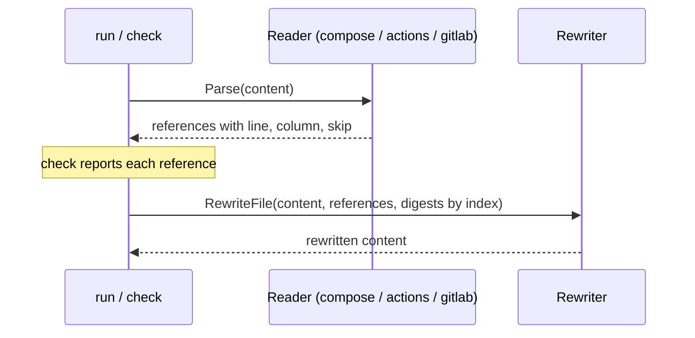

# YAML image references design

[日本語](design.ja.md)

## About this document

This design describes how the references defined in [YAML image references](requirements.md) are read and how digests are written onto them, for the [dockerfile-pin](../../product.md) command-line tool.

### Audience

People and agents who change how compose files, GitHub Actions files, or GitLab CI files are read or rewritten.

### Prerequisites

The YAML notions of nodes, anchors, aliases, and merge keys, and the [YAML merge key type](https://yaml.org/type/merge.html).

### Outside this document

Deciding a file's kind, resolving digests, and producing the output of `run` and `check` are described by their own features.

## Implementation approach

Each kind of YAML file has its own reader and rewriter, `internal/compose`, `internal/actions`, and `internal/gitlab`, with the same shape.
`run` and `check` call the reader for a file to get its references, decide which references need a digest, and `run` then hands the chosen digests to the rewriter for the same file.

### Reading

The reader decodes the file into a `yaml.Node` tree from `gopkg.in/yaml.v3`, whose nodes keep the line and column where their text starts.
It walks only the keys listed in the Requirements, using a helper `findMapValue` that scans a mapping's key and value pairs for a key with the given text and returns its value node.
For each value found, it records the text as written, splits it at the first `@` into image and digest, and marks it skipped when a skip rule applies.

`findMapValue` compares key text only.
It does not follow an alias node to the node it names, and it treats a merge key `<<` as an ordinary key, so a mapping merged into a service or job is not searched.
When the value found is itself an alias, the GitHub Actions and GitLab CI readers drop it because they accept only scalar nodes; the compose reader takes the alias node's value, which is the anchor name.

The GitLab CI reader uses a decoder loop so that every document of the file is read, since a CI component puts its `spec:` in a separate header document.

### Rewriting

The rewriter splits the content into lines and replaces each chosen reference on its recorded line.
It processes references on one line from the rightmost column to the leftmost, because inserting a digest only shifts the text after it, so the columns of the references still to come stay valid.
For each reference it searches for the reference text starting at its recorded column rather than splicing at that column, because a quoted scalar's column points at its opening quote.
The new text is the image before any existing `@`, followed by `@` and the digest, with the `docker://` prefix restored for GitHub Actions references that had it.

Column-based replacement was introduced in [#51](https://github.com/azu/dockerfile-pin/pull/51), because flow syntax puts several references on one line, a reference can be a prefix of another, and digest lengths shift columns.
Why the file is changed as text instead of being re-encoded from the node tree is not recorded.

## Architecture and sequence diagrams

## Data model and ER diagrams

Each reader returns its own reference type, `ComposeImageRef`, `ActionsImageRef`, or `GitLabImageRef`.
They share `RawRef` (the text as written), `ImageRef` (without digest), `Digest`, `Line` and `Column` (1-based), `Skip`, and `SkipReason`.
`ComposeImageRef` adds `ServiceName`; `ActionsImageRef` adds `Location` and `HasPrefix` for `docker://`; `GitLabImageRef` adds `Location` and `Key`, the key that holds the reference.
A relationship diagram is unnecessary because each file yields a flat list.

## APIs and interfaces

### Reader

`Parse(content []byte)` returns the references of one file in the order they are found.
It returns an error wrapping `parsing YAML` when the content is not valid YAML; the caller prints the error with the file name and continues with the next file.
A compose file whose root is not a mapping, or whose `services` is not a mapping, is an error; such shapes in GitHub Actions and GitLab CI files yield no references.

### Rewriter

`RewriteFile(content string, refs []..., digests map[int]string)` returns the rewritten content.
`digests` is keyed by the index of the reference in `refs`, and references that are skipped or have no entry are left unchanged.
When the reference text is not found from its column, the line is left unchanged.

## External service integration

None. The only dependency is the `gopkg.in/yaml.v3` library. Why it was chosen over other YAML libraries is not recorded.

## Data handling

References exist only in memory while the command runs. Nothing is stored.

## Authentication and authorization notes

None. The feature reads and writes local files with the permissions of the user running the command.

## Security considerations

The rewriter changes only the reference text on its recorded line, so the rest of the file is written back byte for byte.

## Deployment notes

None.

## Alternatives considered

No record of the alternatives considered for the reader and rewriter exists.

## Open questions

None.
