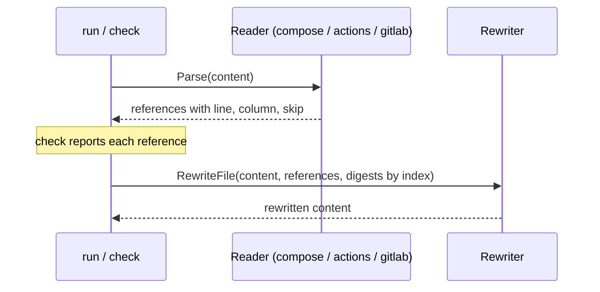

# YAML image references design

[日本語](design.ja.md)

## About this document

This design describes how the references defined in [YAML image references](requirements.md) are read and how digests are written onto them, for the [dockerfile-pin](../../product.md) command-line tool.

### Audience

People and agents who change how compose files, GitHub Actions files, or GitLab CI files are read or rewritten.

### Prerequisites

The YAML notions of nodes, anchors, aliases, and merge keys, and the [YAML merge key type](https://yaml.org/type/merge.html).

### Outside this document

Deciding a file's kind, resolving digests, and producing the output of `run` and `check` are described by their own features.

## Implementation approach

Each kind of YAML file has its own reader and rewriter, `internal/compose`, `internal/actions`, and `internal/gitlab`, with the same shape.
`run` and `check` call the reader for a file to get its references, decide which references need a digest, and `run` then hands the chosen digests to the rewriter for the same file.

### Reading

The reader decodes the file into a `yaml.Node` tree from `gopkg.in/yaml.v3`, whose nodes keep the line and column where their text starts.
It walks only the keys listed in the Requirements, looking each key up through a shared lookup that understands aliases and merge keys.
For each value found, it records the text as written, splits it at the first `@` into image and digest, and marks it skipped when a skip rule applies.
Finally it removes the references that were reached more than once, so that `run` and `check` receive each written reference once.

The GitLab CI reader uses a decoder loop so that every document of the file is read, since a CI component puts its `spec:` in a separate header document.

### Following aliases and merge keys

Add a small package, `internal/yamlnode`, shared by the three readers, and replace each reader's own `findMapValue` with it.
It works on the node tree directly instead of expanding the YAML, because an alias node in `yaml.v3` already points at the node its anchor marks, and that node keeps the line and column of the anchored text.
A reference found through it therefore carries the position inside the anchored node, which is where the rewriter has to write the digest.

`Resolve(node)` follows an alias node to the node it names, repeating while the result is still an alias.
The readers call it on every node they inspect, including the value of `services`, `jobs`, and each entry, before checking the node's kind.
After resolving, the compose reader accepts only scalar nodes for `image`, as the other two readers already do, so `image: *img` yields the anchored scalar instead of the anchor name.

`Lookup(mapping, key)` resolves the mapping, then searches its own key and value pairs for the key, skipping merge keys.
When the key is absent, it visits the merge keys in order. A merge key is a key node tagged `!!merge`, which `yaml.v3` gives to a plain `<<`; a quoted `"<<"` is an ordinary key.
The merge value is resolved and is either a mapping, which is searched with `Lookup`, or a sequence, whose entries are resolved and searched in order, and the first hit is returned.
This order gives the precedence the [YAML merge key type](https://yaml.org/type/merge.html) defines, and the one `docker compose config` produces for `<<: [*a, *b]`.

`yaml.v3` accepts a node that contains an alias to itself, such as `a: &a {b: *a}`, so `Lookup` and the walks that descend into merged mappings keep a set of visited mapping nodes and stop at one they have already entered.

### Removing repeated references

Each reader collects references in the order it finds them and then keeps only the first reference for each pair of line and column.
When the same position is found both skipped and not skipped, as when one compose service with `build` and one without merge the same template, the kept reference is not skipped.
The rewriter is unchanged: since every reference it receives has a distinct position, a digest is never written twice at one place.

`check` prints the line where the reference is written, which for a shared reference is the line inside the template.
`ComposeImageRef.ServiceName` and the `Location` of the other two types name the first service or job that reached the reference.

### Rewriting

The rewriter splits the content into lines and replaces each chosen reference on its recorded line.
It processes references on one line from the rightmost column to the leftmost, because inserting a digest only shifts the text after it, so the columns of the references still to come stay valid.
For each reference it searches for the reference text starting at its recorded column rather than splicing at that column, because a quoted scalar's column points at its opening quote.
The new text is the image before any existing `@`, followed by `@` and the digest, with the `docker://` prefix restored for GitHub Actions references that had it.

Column-based replacement was introduced in [#51](https://github.com/azu/dockerfile-pin/pull/51), because flow syntax puts several references on one line, a reference can be a prefix of another, and digest lengths shift columns.
Why the file is changed as text instead of being re-encoded from the node tree is not recorded.

## Architecture and sequence diagrams

## Data model and ER diagrams

Each reader returns its own reference type, `ComposeImageRef`, `ActionsImageRef`, or `GitLabImageRef`.
They share `RawRef` (the text as written), `ImageRef` (without digest), `Digest`, `Line` and `Column` (1-based), `Skip`, and `SkipReason`.
`ComposeImageRef` adds `ServiceName`; `ActionsImageRef` adds `Location` and `HasPrefix` for `docker://`; `GitLabImageRef` adds `Location` and `Key`, the key that holds the reference.
A relationship diagram is unnecessary because each file yields a flat list.

## APIs and interfaces

### Reader

`Parse(content []byte)` returns the references of one file in the order they are found, with each written reference once.
It returns an error wrapping `parsing YAML` when the content is not valid YAML; the caller prints the error with the file name and continues with the next file.
A compose file whose root is not a mapping, or whose `services` is not a mapping, is an error; such shapes in GitHub Actions and GitLab CI files yield no references.

### Rewriter

`RewriteFile(content string, refs []..., digests map[int]string)` returns the rewritten content.
`digests` is keyed by the index of the reference in `refs`, and references that are skipped or have no entry are left unchanged.
When the reference text is not found from its column, the line is left unchanged.

## External service integration

None. The only dependency is the `gopkg.in/yaml.v3` library. Why it was chosen over other YAML libraries is not recorded.

## Data handling

References exist only in memory while the command runs. Nothing is stored.

## Authentication and authorization notes

None. The feature reads and writes local files with the permissions of the user running the command.

## Security considerations

The rewriter changes only the reference text on its recorded line, so the rest of the file is written back byte for byte.

Following aliases does not copy or expand nodes, so a file with many aliases to one anchor costs one visit per alias rather than growing like an expanded document, and the visited set stops a self-referencing anchor from looping.

## Deployment notes

None.

## Alternatives considered

No record of the alternatives considered for the original reader and rewriter exists. The alternatives below concern following aliases and merge keys.

### Decode into Go maps and let yaml.v3 apply merges

`yaml.v3` applies merge keys when it decodes into `map[string]any`, which would give the merged services directly.
The decoded values lose their line and column, so the rewriter could not find where to write the digest. It is not chosen.

### Expand the anchors in the file

Writing each merged image into the service that uses it would let the current readers work unchanged.
It changes the structure the developer chose and turns one shared template into copies that drift apart. It is not chosen.

### Report anchored images without pinning them

The issue's second option is to flag an unpinned image once a template is merged.
It leaves the developer to pin the template by hand, while the rewriter can already write at the template's position. It is not chosen.

### Selected approach

Following the node tree keeps the positions the rewriter needs and changes only the anchored text, which is also how Renovate fixed the same case: [renovatebot/renovate#35844](https://github.com/renovatebot/renovate/pull/35844) extracts the images used as anchors.

## Open questions

Checking a shared reference when any use does not skip it depends on the open question in the [Requirements](requirements.md#open-questions). If it is decided otherwise, change [Removing repeated references](#removing-repeated-references).
